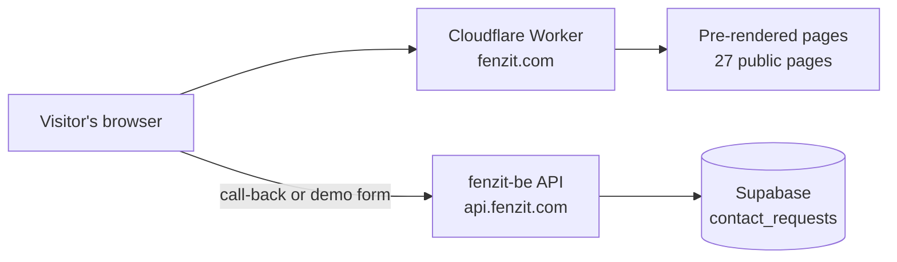

<div align="center">

# fenzit-web

**The public website for Fenzit — field jobs, attendance and leave in one app.**

[](https://github.com/ashishkumar1000/fenzit-web/actions/workflows/deploy.yml)
[](https://github.com/ashishkumar1000/fenzit-web/releases)


[**Live site**](https://fenzit.com) · [**Latest release**](https://github.com/ashishkumar1000/fenzit-web/releases/tag/v0.1.0) · [**Quick start**](#quick-start) · [**Scripts**](#scripts)

</div>

---

## How it fits together



Pages are built to static HTML at build time, so search engines and AI tools read the full content without running JavaScript.

## Quick start

```sh
bun install
cp .env.example .env.local   # set VITE_API_BASE_URL to the fenzit-be origin
bun run dev
```

> Local API calls need fenzit-be to allow `http://localhost:5173`. Add it to `CORS_ALLOWED_ORIGINS` in fenzit-be's `.env`.

This repo uses **Bun only**. Do not run `npm`, `yarn` or `pnpm`.

## Scripts

| Command                           | What it does                                                     |
| --------------------------------- | ---------------------------------------------------------------- |
| `bun run dev`                     | Starts the Vite dev server                                       |
| `bun run build`                   | Type-checks, builds, and pre-renders every public page           |
| `bun run test`                    | Runs the test suite (`bun test`)                                 |
| `bun run lint`                    | ESLint, including import-direction and no-string-className rules |
| `bun run typecheck`               | TypeScript check, no output                                      |
| `bun run format` / `format:check` | Prettier                                                         |
| `bun run check:styles`            | Every component has its paired `.module.css`                     |
| `bun run check:design-system`     | Design tokens match the locked design system                     |
| `bun run deploy`                  | Build, then `wrangler deploy` (CI runs this on `main`)           |

## Pages and contact requests

| Page           | Purpose                                                     |
| -------------- | ----------------------------------------------------------- |
| `/`            | Home, with **Request a call back** and early-access sign-up |
| `/book-demo`   | **Book a demo** form                                        |
| `/pricing`     | Pricing: 90 days free for every team                        |
| `/data-safety` | How company data is kept separate                           |
| `/partners`    | For installers, service companies and resellers             |

Both forms post to `POST /api/v1/contact-requests` on fenzit-be. The browser checks the input first, and fenzit-be checks it again before saving.

## Search and AI visibility

<details>
<summary><b>Pages, sitemap and crawlers</b></summary>

- `PUBLIC_PAGES` in `src/app/pageMeta.ts` is the single list of public pages. The build writes `sitemap.xml` from it.
- `public/robots.txt` allows search engines and named AI crawlers.
- `public/llms.txt` is a plain-language index of the site for AI tools.
- Meta descriptions must be **25 to 160 characters**.

</details>

<details>
<summary><b>Adding or removing a page</b></summary>

1. Add or remove its `PageMeta` in `PUBLIC_PAGES`.
2. For a use-case page, update the content registry in `src/features/use-case/content/`.
3. Add or remove its `href_matches` entry in the speculation rules in `index.html`.
4. Update `public/llms.txt`.
5. After deploy, submit the new URLs to IndexNow (see below).

The build and tests fail if steps 1 and 3 don't match.

</details>

<details>
<summary><b>Bing and IndexNow</b></summary>

- **Bing Webmaster Tools** is verified with `public/BingSiteAuth.xml`. Keep that file in place.
- **IndexNow** key: `public/3c7da65a76eb496dadb168fe80b707d8.txt`. After a change, POST to `https://api.indexnow.org/indexnow` with `{ host, key, keyLocation, urlList }`. A `202` means accepted.
- **Cloudflare Crawler Hints** is on for the zone. It also signals changes to search engines. It's set in the Cloudflare dashboard, not in this repo.
- **Google Search Console:** verify a Domain property with a DNS TXT record, then submit `https://fenzit.com/sitemap.xml`.

</details>

## Deploy

- Every push to `main` deploys to fenzit.com. Check the build before you push.
- The workflow runs in the `Fenzit-web` GitHub environment and needs `CLOUDFLARE_API_TOKEN` and `CLOUDFLARE_ACCOUNT_ID`.
- It runs on `ubuntu-latest`, which GitHub is moving to Ubuntu 26.04 through November 2026, and uses `actions/checkout@v5`.
- `www.fenzit.com` redirects to the apex with path and query kept.

---

<div align="center">

Built for field teams. See [`CLAUDE.md`](CLAUDE.md) for the rules agents and contributors follow in this repo.

</div>
